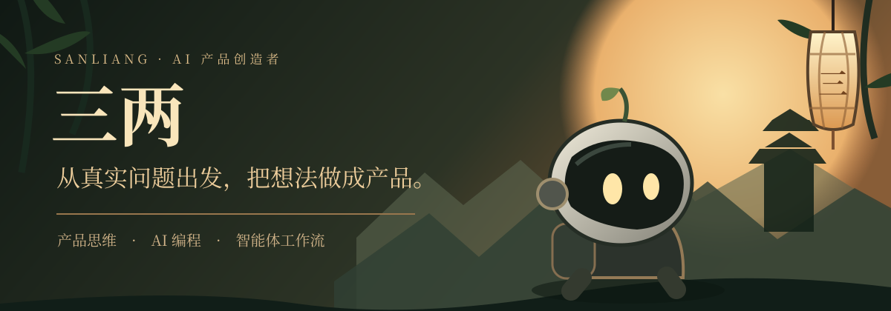
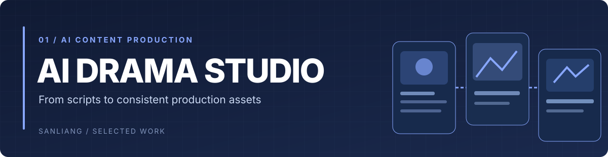
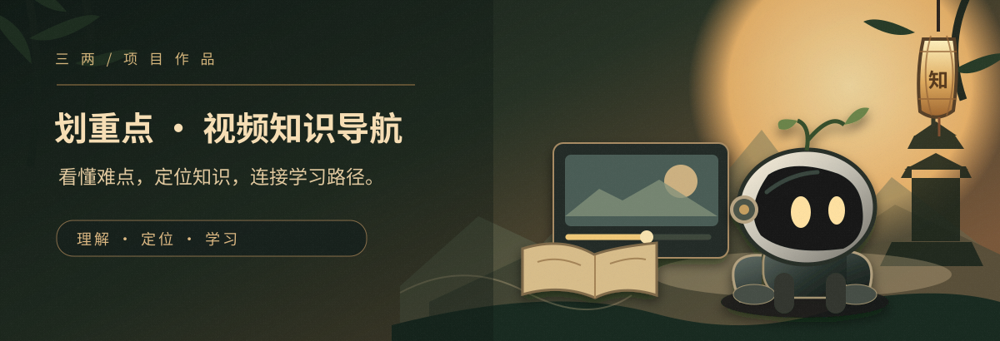
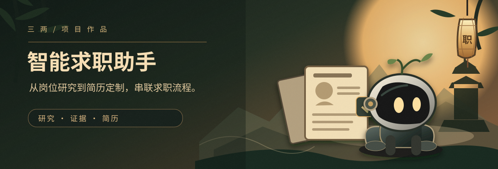
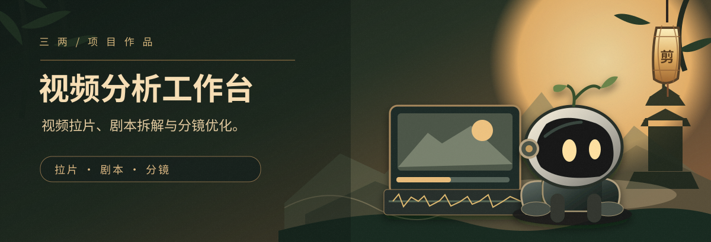

  

我是 **三两 · Sanliang**，一个以产品思维做 AI 创造的人。

关注 **AI 原生产品、Agent 工作流与内容创作工具**。习惯先拆解真实问题，再设计流程，借助 AI Coding 快速构建，并通过测试与使用反馈持续修正。

**好的产品，是用巧妙的方式，解决真实的问题。**

[从 AI 内容生产开始](https://github.com/5JjiaLin/ai-drama-production-studio) · [探索视频知识理解](https://github.com/5JjiaLin/key-points-ai-video) · [试试求职 Agent](https://github.com/5JjiaLin/JobHuntBot) · [全部公开仓库](https://github.com/5JjiaLin?tab=repositories)

---

## 01 / 从这里开始

这三个项目分别代表我在 **实际业务流程、用户产品体验、Agent 系统设计** 三个方向上的探索。

### ① AI 漫剧生产：让制作流程更可控

当人物设定、场景、道具与分镜散落在不同文档中，制作效率和一致性都会受到影响。

**AI Drama Production Studio** 将剧本导入、资产提取与确认、分镜生成、人工修订和导出放进同一工作区。核心不是「一键出片」，而是让 AI 生成过程可以**管理、追溯、修改和交付**。

**产品关注：** 业务流程拆解 · 资产一致性 · 人机协作 · AI 内容生产

[查看项目与部署方式 →](https://github.com/5JjiaLin/ai-drama-production-studio)

查看真实产品界面

### ② 划重点：让知识视频不只是「看过」

普通视频摘要可以告诉你「讲了什么」，却未必解决「哪里没懂、怎么回看、看完如何组织知识」。

**划重点 · Key Points** 围绕一个完整的学习体验设计三条链路：

**播放时补懂难点 → 单视频知识定位 → 多视频学习路径重构**

从轻提示、知识点时间区间到带来源的学习路径，重点是将模型输出变成**可理解、可验证、可操作的产品功能**。

**产品关注：** 用户需求分析 · AI 功能设计 · 证据追溯 · 质量评测

[查看产品 Demo 与实现说明 →](https://github.com/5JjiaLin/key-points-ai-video)

查看已实现的产品界面

### ③ JobHuntBot：把一次对话变成持续工作流

AI 可以改写简历，但如果不了解行业、岗位要求和候选人的真实能力，漂亮的文字也很难解决求职问题。

**JobHuntBot** 为 Codex / Claude Code 定义可复用的求职流程：

**行业研究 → 目标企业与 JD → 能力模型 → 经历证据 → 定制简历 → 岗位匹配与投递跟踪**

通过分阶段的 Agent Harness，让输出有依据、步骤可检查、求职资料保存在本地工作区。

**产品关注：** Agent Harness · 任务规划 · 证据约束 · 工作流自动化

[查看项目与使用指南 →](https://github.com/5JjiaLin/JobHuntBot)

---

## 02 / 给创作者的工具

### Pro Video Analyst：视频分析与分镜创作

将**视频拉片、剧本拆解、分镜优化**放进一个浏览器工作台。辅助创作者分析景别、镜头节奏与画面风格，并整理后续制作使用的脚本和提示词。

它与 AI 漫剧生产工作台是**独立项目**，但都来自同一个问题：如何让 AI 视频制作少一些重复沟通，多一些可复用的结构化信息。

[查看项目 →](https://github.com/5JjiaLin/pro-video-analyst)

查看真实产品界面

---

## 03 / 我的产品构建方法

我的关注点不只是模型能力，而是 **从问题到交付的整个闭环**。

| 阶段 | 核心问题 | 对应实践 |
| :--- | :--- | :--- |
| **Discover · 发现** | 用户真正卡在哪里？业务约束是什么？ | 划重点：拆分理解障碍与知识定位场景 |
| **Design · 设计** | 哪些步骤该交给 AI，哪些需要人来控制？ | AI 漫剧：资产确认、分镜编辑和流程衔接 |
| **Build · 构建** | 如何把方案快速做成可用的东西？ | 通过 AI Coding 完成工作台和交互原型 |
| **Evaluate · 验证** | 结果是否可靠？失败时如何处理？ | Schema 校验、测试、Bad Case 与迭代 |

**关键词：** Product Thinking · AI Coding · Agent / Skills · Prompt & Workflow Design · Human-in-the-loop · AI Evaluation

---

## 04 / 持续探索

- **AI × 创作**：从单点生成工具走向更完整、更可控的内容生产流程。
- **AI Agent × 真实任务**：探索可复用的 Skills、工作流、评测与长期任务管理。
- **AI × 学习**：让内容理解、场景练习与知识复习形成连续体验。

这里记录的是已经公开的作品，以及仍在不断尝试的方向。探索中的想法不等于已经上线的产品。

---

## 05 / 保持联系

如果你也关心 AI 产品如何真正落地，欢迎通过开源项目交流想法、问题和改进建议。

[浏览所有公开项目](https://github.com/5JjiaLin?tab=repositories) · [访问我的 GitHub](https://github.com/5JjiaLin)

**先理解问题，再把它做出来。**

Think in products. Build with AI. Keep learning.

